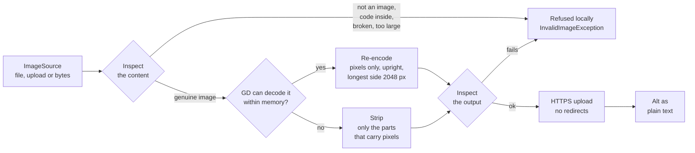

# dockaccess alt generator - PHP core

A dependency-free PHP client for the [dockaccess.org](https://dockaccess.org) alt text generator.
It is the core that the CMS and framework integrations (WordPress, PrestaShop, Joomla, Drupal,
Magento, Laravel, Symfony) build on, so everything that has to be right everywhere lives here:

- **only genuine images leave the server.** Every file is identified from its content, parsed
  structure by structure, checked for embedded PHP and PHAR stubs, and rebuilt before it is sent.
  A `shell.php` renamed to `photo.png`, PHP hidden in a JPEG comment, an SVG with a script or a
  decompression bomb is refused locally and never reaches the network.
- **no metadata leaks.** The uploaded file is re-encoded from pixels (or, without GD, stripped to
  the parts that carry pixels), so GPS positions, camera serials, author names, editing history,
  embedded thumbnails and anything appended after the image stay on the server.
- **the account key does not leak.** It is held masked in memory and redacted from exceptions,
  stack traces, `var_dump()`, `json_encode()` and serialization.

The threat model and what each layer guarantees are in [SECURITY.md](SECURITY.md).

## Requirements

- PHP 7.4 to 8.5, 64-bit
- `ext-curl` and `ext-json`
- `ext-gd` with JPEG, PNG, GIF and WebP support - strongly recommended. Without it images are
  stripped byte by byte instead of re-encoded, and AVIF and HEIC cannot be sent at all.
- `ext-mbstring` is optional

## Installation

```bash
composer require dockcodes/dockaccess-alt-generator
```

Plugins that ship their own code (WordPress, PrestaShop, Joomla and Magento modules installed
from a zip) bundle the library under a namespace of their own, so two plugins carrying different
versions cannot load each other's classes:

```bash
php bin/bundle.php ../my-plugin/vendor/dockcodes/dockaccess-alt-generator 'MyPlugin\Vendor' --guard=ABSPATH
```

```php
require __DIR__ . '/vendor/dockcodes/dockaccess-alt-generator/autoload.php';

use MyPlugin\Vendor\Dock\AltGenerator\AltGenerator;
```

The target receives `src/` with every `Dock\AltGenerator` reference prefixed, an `autoload.php`,
the `LICENSE` and a `bundle.json` with the version and the SHA-256 of every file. Every PHP file
opens with a header naming the package, its version and the MIT License, the license notice the
Joomla Extensions Directory checks each file for. `--guard` adds `defined('CONSTANT') || exit;` to
every file for platforms that require it (`ABSPATH`, `_JEXEC`, `_PS_VERSION_`), and `--index` puts
the redirecting `index.php` PrestaShop modules need into every directory:

```bash
php bin/bundle.php ../my-module/vendor/dockcodes/dockaccess-alt-generator 'MyModule\Vendor' --guard=_PS_VERSION_ --index
``` The bundle is built next to the target and only replaces it once every file
parses, and a directory the script did not write is never overwritten.

## Quick start

```php
use Dock\AltGenerator\AltGenerator;
use Dock\AltGenerator\Config;
use Dock\AltGenerator\GenerateOptions;
use Dock\AltGenerator\Image\ImageSource;

$generator = new AltGenerator(Config::create($accountKey));

$image  = ImageSource::fromFile($path, [$uploadsDirectory]);
$result = $generator->generate($image, GenerateOptions::create()->withLanguage('pl_PL'));

echo htmlspecialchars($result->alt()->text(), ENT_QUOTES, 'UTF-8');
```

The account key is the token shown in the dockaccess.org account. The returned alt is already
plain text (no markup, control characters or invisible bidirectional overrides), but it is text
from outside - escape it wherever it is printed, as you would any other input.

## What happens to an image



`ImagePolicy::MODE_REENCODE` replaces the strip branch with a refusal, `MODE_STRIP` always takes it.
Nothing is sent before the output has passed the second inspection.

What the package does with these files (built by `tests/Support/Images.php`, each kind covered by
the test suite):

| File | Result |
|---|---|
| 4000 × 3000 photo, EXIF orientation 6 with GPS and owner, XMP, IPTC, a comment | Sent as a re-encoded JPEG, 1536 × 2048 (turned upright), no metadata |
| The same photo on a server without GD | Sent stripped, 4000 × 3000, no metadata, the orientation kept as a one-tag EXIF |
| 800 × 600 PNG with transparency | Sent as a re-encoded WebP, `logo.webp` |
| JPEG whose JFIF thumbnail shows the picture before it was cropped | Sent without the thumbnail |
| `shell.php` renamed to `photo.png` | Refused: `embedded_code` |
| Valid PNG with PHP appended | Refused: `embedded_code` |
| Valid JPEG with PHP in a comment | Refused: `embedded_code` |
| Valid JPEG that is also a PHAR archive | Refused: `embedded_code` |
| SVG with a script | Refused: `unsupported_format` |
| HTML behind a GIF signature | Refused: `malformed` |
| PNG claiming 60000 × 60000 px | Refused: `bad_dimensions` |
| PNG with a broken checksum | Refused: `malformed` |
| WebP whose size field lies | Refused: `malformed` |

## Image sources

| Constructor | Use for |
|---|---|
| `ImageSource::fromFile($path, $allowedDirectories)` | A file on disk. It is read only if its real path (symlinks resolved) lies inside one of the allowed directories. Stream wrappers (`phar://`, `http://`, `php://`) are refused. |
| `ImageSource::fromUpload($_FILES['image'])` | A file PHP received in the current request; anything that did not come through `is_uploaded_file()` is refused. |
| `ImageSource::fromBytes($bytes, $name)` | Bytes the integration already holds, such as a framework's uploaded file object. |

Name the narrowest directory that holds images, never the document root:

| Platform | Allowed directory |
|---|---|
| WordPress | `wp_upload_dir()['basedir']` |
| PrestaShop | `_PS_IMG_DIR_` |
| Joomla | `JPATH_ROOT . '/images'` |
| Drupal | `\Drupal::service('file_system')->realpath('public://')` - pass real paths, not `public://` URIs |
| Magento | `$directoryList->getPath(DirectoryList::MEDIA)` |
| Laravel | `Storage::disk('public')->path('')` |
| Symfony | `%kernel.project_dir%/public/uploads` |

The file name is only a hint: it is reduced to `[A-Za-z0-9_-]`, given the extension of the format
actually sent, and never used to decide what the file is.

## Options

```php
use Dock\AltGenerator\Tone;

$options = GenerateOptions::create()
    ->withLanguage('de_AT')          // any locale; reduced to a supported language ("de"), or an exception
    ->withTone(Tone::DESCRIPTIVE)    // see Tone::ALL
    ->withContext('Product: oak dining table, 180 cm')  // up to 500 characters, plain text
    ->withVariants(3)                // 1 to 3 alternatives
    ->withSetRef('wp-site-42');      // groups images into one set in the account
```

`Language::normalize($locale, 'en')` maps a CMS locale to a supported language with a fallback,
for when an unsupported site language should not stop the generation.

## Results

```php
$result->alt();          // the first Alt: ->text(), ->locale()
$result->alts();         // all variants
$result->imageUuid();    // the image in the dockaccess.org account
$result->setUuid();      // the set it was added to
$result->image();        // what was actually sent: ->bytes(), ->format(), ->width(), ->height(), ->method(), ->sha256()

$usage = $generator->usage();    // ->used(), ->limit(), ->remaining(), ->isExhausted()
```

`$generator->prepare($image)` verifies and sanitizes without sending anything - useful to refuse
a bad file at upload time or before queueing a bulk run.

Alts that reach the site another way, such as those dockaccess.org pushes to a connected site,
go through the same cleaning as generated ones:

```php
use Dock\AltGenerator\Text\PlainText;

$alt = PlainText::clean($pushedAlt, 2000);   // one line: no markup, controls, direction overrides or zero-width characters
```

## Errors

Every exception implements `Dock\AltGenerator\Exception\AltGeneratorException`. None of them
carries the account key, the request URL's query or the image bytes.

| Exception | Meaning | What to do |
|---|---|---|
| `InvalidImageException` | Refused locally, nothing was sent. `getReason()`: `not_allowed`, `empty`, `too_large`, `unsupported_format`, `malformed`, `bad_dimensions`, `embedded_code`, `cannot_sanitize` | Show the reason; do not retry |
| `ConfigurationException` | Invalid configuration (bad URL, no allowed directory, invalid option) | Fix the integration |
| `AuthenticationException` | The key is unknown or disabled (403) | Ask the site owner to check the key |
| `DailyLimitReachedException` | The plan's daily limit is used up; `getDailyLimit()` | Stop until tomorrow, offer an upgrade |
| `RateLimitedException` | Too many requests per minute; `getRetryAfter()` in seconds | Retry after that delay |
| `ImageRejectedException` | The API refused the image (400, 413, 415) | Do not retry this image |
| `ServerException` | The API failed (5xx) | Retry later with backoff |
| `TransportException` | No complete answer (DNS, TLS, timeout, oversized answer); `isRetryable()` is true only when nothing reached the API | Retry later |
| `UnexpectedResponseException` | An answer the client does not understand (redirect, invalid JSON) | Log and report |

`ApiException::getApiMessage()` returns the API's own message, cleaned to plain text.

## Configuration

```php
use Dock\AltGenerator\Image\ImagePolicy;

$config = Config::create($accountKey)
    ->withTimeouts(5000, 90000)              // connect and total, in milliseconds
    ->withConnectRetries(1)                  // retries only failures before anything was sent
    ->withProxy($proxyUrl)                   // e.g. WP_PROXY_HOST; redacted like the key
    ->withCaBundle('/etc/ssl/certs/ca.pem')  // when the system CA store is outdated
    ->withUserAgentSuffix('wordpress/6.8 dockaccess-alt/1.2.0')
    ->withImagePolicy(
        ImagePolicy::secure()
            ->withMaxBytes(5 * 1024 * 1024)
            ->withMaxEdge(2048)              // longest side of the image sent
            ->withMode(ImagePolicy::MODE_REENCODE)
    );
```

Image modes:

| Mode | Behaviour |
|---|---|
| `MODE_AUTO` (default) | Re-encode with GD when it can decode the format and the bitmap fits into the memory PHP has left; otherwise strip metadata byte by byte |
| `MODE_REENCODE` | Re-encode or refuse. The strictest choice: only GD-written bytes are sent |
| `MODE_STRIP` | Never decode; strip metadata. For servers where decoding large images is too expensive |

`withBaseUrl()` accepts only `https://` URLs. Plain `http://` is possible only for loopback
addresses after `allowInsecureLoopback()`, which exists for tests.

## Custom transport

The default transport uses cURL. An integration that has to go through the platform's HTTP client
can implement `Http\TransportInterface`, but it must keep the guarantees of `CurlTransport`: HTTPS
with peer and host verification, TLS 1.2 or newer, no redirects, bounded timeouts, a cap on the
response size, and error messages that never contain the request URL.

## Development

```bash
composer install
composer test                     # unit and integration tests (local stub server)
composer analyse                  # PHPStan, level max
tests/docker/run.sh               # the suite on PHP 7.4, 8.1 and 8.4 in Docker
DOCKACCESS_ALT_NETWORK_TESTS=1 vendor/bin/phpunit --filter NetworkTest
```

The network tests check certificate validation against badssl.com and call the real API with a
made-up key, which the API refuses before it reads the image: nothing is stored and no limit is used.

GitHub Actions (`.github/workflows/tests.yml`) runs the suite on PHP 7.4 to 8.5 and PHPStan on every
push and pull request. The network tests run there weekly and on demand (Actions → Tests → Run workflow),
so an outage of badssl.com or the API does not fail a push.

## License

MIT, see [LICENSE](LICENSE).
